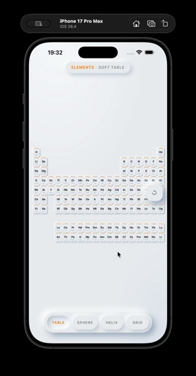
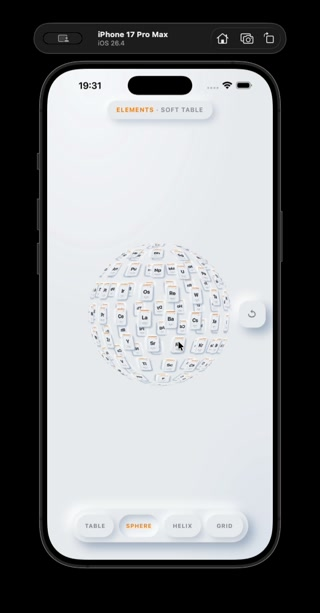
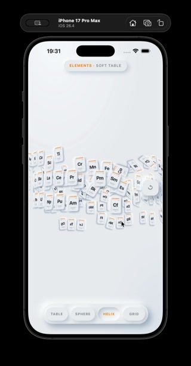
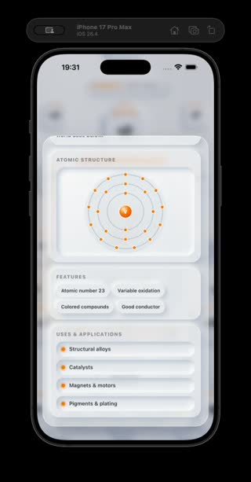

# Elements — Soft Table

An iOS app that turns the classic [three.js CSS3D periodic table](https://threejs.org/examples/css3d_periodictable.html) into a touch-first experience: soft neumorphic tiles, four animated layouts, pinch zoom, orbit, and a glass-style detail sheet for every element.

Built as a native SwiftUI shell around a bundled Three.js scene (no network required at runtime).

---

## Demo

https://github.com/shahryaralam688/ThreeJSPeriodicTable/raw/main/docs/demo/periodic-table-demo.mp4

<video src="docs/demo/periodic-table-demo.mp4" controls playsinline width="280" poster="docs/demo/preview-table.jpg">
  Your browser does not support the video tag. <a href="docs/demo/periodic-table-demo.mp4">Download the demo</a>.
</video>

Full-resolution screen recording (Simulator): [`docs/demo/Screen-Recording-2026-10-10.mov`](docs/demo/Screen-Recording-2026-10-10.mov)

| Table | Sphere | Helix | Detail |
| :---: | :---: | :---: | :---: |
|  |  |  |  |

---

## What you can do

- **Browse all 118 elements** as individual CSS3D cards (symbol, name, atomic mass).
- **Switch layouts** from the bottom bar:
  - **Table** — classic periodic arrangement (including lanthanides / actinides).
  - **Sphere** — elements mapped onto a sphere.
  - **Helix** — spiral / DNA-style path.
  - **Grid** — layered 3D grid.
- **Orbit** with one finger; **pinch** to zoom in and out (wide range — pull back until the whole set is tiny, or move in close on a single tile).
- **Reset** (floating control on the right) recenters the camera for whichever layout is active.
- **Tap an element** to open a glassmorphic sheet with:
  - category chip, mass, electron count, shell summary  
  - Bohr-style atomic structure diagram  
  - feature tags  
  - common uses / applications  

---

## Design

The UI follows a soft neumorphic system (raised and inset surfaces, dual shadows) with an orange accent for active states — inspired by soft-UI fitness / dashboard references, adapted for a science viewer.

| Token | Value | Use |
| --- | --- | --- |
| Surface | `#EBECF0` | Page + tile base |
| Accent | `#FF8A00` | Active tab, highlights, nucleus |
| Text | `#3A3D45` / `#8A8F9A` | Primary / secondary |
| Glass sheet | frosted white + `backdrop-filter` | Element detail overlay |

Typography uses the system SF stack so it feels at home on iPhone.

---

## Architecture

```
SwiftUI App
 └─ WKWebView (ThreeJSWebView)
      └─ appcontent:// → bundled WebContent/
           ├─ index.html + main.css
           ├─ app.js              scene, layouts, gestures, detail sheet
           ├─ elements-data.js    element metadata + Bohr SVG helper
           ├─ build/three.module.js
           └─ jsm/                CSS3DRenderer, OrbitControls, tween
```

Why this split:

- **Swift / SwiftUI** — installable iOS app, safe area, simulator/device target.
- **WKWebView + custom URL scheme** — loads local ES modules offline without a file:// CORS mess.
- **Three.js CSS3DRenderer** — keeps crisp HTML/CSS typography and neumorphic shadows on every tile (harder to fake well with canvas-only text).

---

## Project layout

```
ThreeJSPeriodicTable/
├── README.md
├── project.yml                         # XcodeGen spec
├── ThreeJSPeriodicTable.xcodeproj/
├── ThreeJSPeriodicTable/               # Native shell
│   ├── ThreeJSPeriodicTableApp.swift
│   ├── ContentView.swift
│   ├── ThreeJSWebView.swift            # WKWebView + LocalWebSchemeHandler
│   └── Assets.xcassets/
├── WebContent/                         # Bundled web / 3D runtime
│   ├── index.html
│   ├── main.css
│   ├── app.js
│   ├── elements-data.js
│   ├── build/three.module.js
│   └── jsm/
└── docs/demo/                          # Screen recording + stills
    ├── periodic-table-demo.mp4
    ├── Screen-Recording-2026-10-10.mov
    └── preview-*.jpg
```

---

## Requirements

- macOS with **Xcode 16+** (or current Xcode that can target iOS 16)
- iOS **16.0+** Simulator or device
- Optional: [XcodeGen](https://github.com/yonaskolb/XcodeGen) if you regenerate the project from `project.yml`

---

## Run

1. Clone the repo and open `ThreeJSPeriodicTable.xcodeproj` in Xcode.
2. Select an iPhone Simulator (or a signed device).
3. Set your **Signing Team** if needed.
4. **Product → Run**.

Regenerate the Xcode project after editing `project.yml`:

```bash
cd ThreeJSPeriodicTable
xcodegen generate
open ThreeJSPeriodicTable.xcodeproj
```

CLI build example:

```bash
xcodebuild \
  -project ThreeJSPeriodicTable.xcodeproj \
  -scheme ThreeJSPeriodicTable \
  -destination 'platform=iOS Simulator,name=iPhone 16 Pro' \
  -configuration Debug \
  build \
  CODE_SIGNING_ALLOWED=NO
```

### Gestures (Simulator)

| Gesture | How in Simulator |
| --- | --- |
| Orbit | Click + drag |
| Pinch zoom | Hold **Option (⌥)** → two dots → drag |
| Pan (two-finger) | **Option + Shift** |
| Open detail | Click a tile |
| Reset camera | Tap the floating reset control on the right |

---

## Tech stack

| Layer | Pieces |
| --- | --- |
| Native | Swift 5, SwiftUI, WebKit (`WKWebView`, custom `WKURLSchemeHandler`) |
| 3D / UI | Three.js (r170), `CSS3DRenderer`, `OrbitControls`, TWEEN |
| Styling | CSS variables, neumorphism, glassmorphic detail sheet |
| Tooling | Xcode / XcodeGen (`project.yml`) |

---

## Notes

- Web content is **bundled** — the app does not fetch Three.js from a CDN.
- Camera reset targets the **centroid of the active layout** (table / sphere / helix / grid), not a hard-coded world origin.
- Pinch zoom is handled with an explicit touch path on top of OrbitControls so zoom-out stays usable inside `WKWebView`.

---

## Credits

- Periodic table interaction pattern from the [three.js CSS3D periodic table example](https://threejs.org/examples/css3d_periodictable.html) (MIT).
- Three.js — [mrdoob/three.js](https://github.com/mrdoob/three.js).

---

## License

Source in this repository is provided for portfolio / educational use unless otherwise noted. Three.js remains under its own MIT license.
